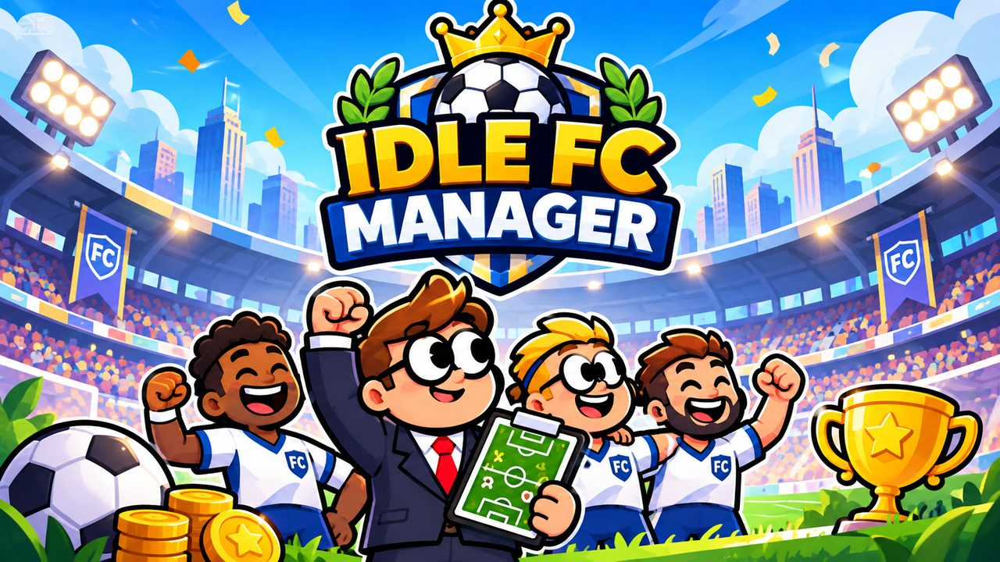

# ⚽ Idle FC Manager



Jeu **idle / tycoon de football** jouable dans le navigateur, en français et en anglais.
Pars de la Ligue 4 avec un club de quartier, monte jusqu'en Ligue 1, puis remporte la Ligue des Légendes.

[](https://vercel.com/new/clone?repository-url=https%3A%2F%2Fgithub.com%2FN04H2004%2FIdle-FC-Manager&project-name=idle-fc-manager)

## Contenu

- **Revenus passifs** : boutique, stade, sponsors, restaurant VIP, chaîne du club, multipliés par les supporters, la division et la série de victoires.
- **Championnat** de 10 clubs sur 18 journées, avec montées (licence requise), descentes et rivaux.
- **Effectif** : compo automatique ou manuelle (4-4-2), forme des joueurs, salaires, centre de formation.
- **Marché des transferts** et **boosters** avec animation d'ouverture des cartes (Commun, Rare, Épique, Légendaire).
- **Prestige** (refondations et bonus permanents), objectifs du jour, cadeaux de connexion, succès et records.
- Blason, maillot et bannière personnalisables ; musique et effets sonores générés dans le navigateur.
- Didacticiel guidé, sauvegarde automatique (`localStorage`) et gains hors ligne.

## Structure

Le jeu tient dans un seul fichier, sans dépendance ni étape de build :

```
index.html   le jeu complet (HTML + CSS + JavaScript)
cover.jpg    image de couverture
vercel.json  configuration Vercel (site statique)
```

Pour jouer en local, ouvre `index.html` dans un navigateur, ou lance un petit serveur :

```bash
python3 -m http.server 8000
```

## Déploiement sur Vercel

1. Va sur <https://vercel.com/new> (ou clique sur le bouton ci-dessus) et importe le dépôt `N04H2004/Idle-FC-Manager`.
2. Laisse **Framework Preset : Other**, sans commande de build ni dossier de sortie.
3. Clique sur **Deploy**. Chaque push redéploie le jeu automatiquement.
